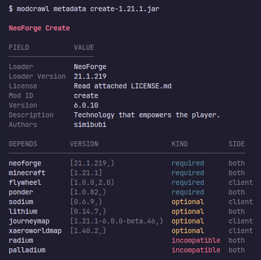

<div align="center">


[](https://crates.io/crates/modcrawl)
[](https://github.com/SirCesarium/modcrawl/actions)
[](https://github.com/SirCesarium/modcrawl/blob/main/LICENSE)

</div>

Analyze **Minecraft mods and plugins** to find out which loader they belong to, which dependencies they have, and even **inspect their byte code** to find out **why your modpack is crashing**.

## What is `modcrawl`

`modcrawl` is an all-in-one **Minecraft utility** as a **CLI**, a **Rust library**, and an **npm package** designed to **help modpackers** and **server admins** to inspect, organize, and debug modpacks without the headache.

It helps you quickly answer the everyday questions that pop up while building or fixing a modpack:

- **Clean up mixed mod loaders:** Easily spot and remove leftover Fabric mods in a NeoForge modpack (like when **moving away from Sinytra Connector**).
- **Separate Client, Server, and Both:** Quickly **identify client-only mods** mixed into a **server folder** so you can purge them before launching.
- **Find the culprit behind cryptic crashes:** When a crash log gives you an obfuscated Java method call but doesn't mention which mod broke, trace references directly back to the offending JAR.
- **Catch conflicts before they happen:** Identify duplicate classes or overlapping mixin targets across multiple mods that might collide on startup.
- **Inspect metadata instantly:** Check mod loaders, dependencies, versions, and internal file lists without manually unzipping every JAR.

### Example of `modcrawl`'s output

<div align="center">



</div>


## Quickstart

```bash
# Detect mod loader
modcrawl type MyMod.jar

# Inspect metadata and dependencies
modcrawl deps MyMod.jar

# Find duplicate classes causing conflicts
modcrawl dupes *.jar

# Search for obfuscated method references across all JARs
modcrawl grep "net/minecraft/world" *.jar --quiet
```

## TL;DR - Shut up and let me download

The binaries are uploaded into the [releases](https://github.com/SirCesarium/modcrawl/releases) section of the GitHub repository. You can download the latest version of `modcrawl` for your platform from there.

### Quick downloads

<div align="center">

<!-- TODO make the download buttons actually work -->

<a href="https://github.com/SirCesarium/modcrawl/releases"></a>
<a href="https://github.com/SirCesarium/modcrawl/releases"></a>
<a href="https://github.com/SirCesarium/modcrawl/releases"></a>
<a href="https://github.com/SirCesarium/modcrawl/releases"></a>

</div>

Those quick downloads point to the most common OS architectures (eg., `Windows x86_64`, `Debian x86_64`, ...). If you have an uncommon architecture (like `Debian ARM64`) you can check the [releases](https://github.com/SirCesarium/modcrawl/releases) page.

Or even check the [Installation](#installation) section.

## Supported loaders

These are the loaders that `modcrawl` currently supports.

*Feel free to contribute to the list while opening a **Pull request**!* ❤️

| Loader | Status | Type |
| --- | --- | --- |
| NeoForge | ✅ | Mods |
| Fabric | ✅ | Mods |
| Forge | ✅ | Mods |
| Forge (legacy `<1.12`) | ✅ | Mods |
| Quilt | ✅ | Mods |
| Bukkit | ✅ | Plugins |
| Paper | Metadata, not dependencies | Plugins |
| Bungee | Metadata, not dependencies | Plugins |
| Velocity | Metadata, not dependencies | Plugins |

## Installation

Before all, **make sure** you have the **Rust Programming Language** installed on your machine, if not, [click here](https://rust-lang.org/).

### Install with cargo

- Just run `cargo install modcrawl` and you're good to go!

### Build from source

- Clone the repository `git clone https://github.com/SirCesarium/modcrawl.git` and navigate to the `modcrawl` directory.
- Install `modcrawl` with `cargo install --path .`.

## Web

There's a **WIP** web version of `modcrawl` that aims to provide all of the features of `modcrawl` in a more user-friendly way and will work completely offline (thanks to `WASM`!). It's still in development (currently there's not even a MVP), so expect some bugs and missing features. Stay tuned in [GitHub Discussions](https://github.com/SirCesarium/modcrawl/discussions) for any major updates :).
  
> [!NOTE]
> There will be a structured documentation when the web version reaches a stable state.
>
> The documentation will show a deep overreview about all of the commands and the *API Reference* of the **Rust Library** and the **NPM (TypeScript) Library**

### Web setup

- Clone the repository `git clone https://github.com/SirCesarium/modcrawl.git` and navigate to the `modcrawl/web` directory.
- Make sure you have **Bun Runtime** installed on your machine, if not, click [here](https://bun.sh/) to install it.
- Run `bun install --frozen-lockfile` to install the dependencies.
- Run `bun run dev` and navigate to `http://127.0.0.1:5173` in your browser.

## License

This project is licensed under the terms of the MIT license. See [LICENSE](./LICENSE) for details.
